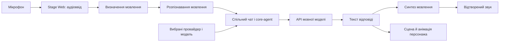

# AIRI: огляд проєкту

**Зріз коду:** commit `91953f0380bc9dca6a9d4082b91510aa4e030559` (`main`, 2026-10-06).

## Що це за проєкт

AIRI — відкритий проєкт віртуального AI-персонажа. Він поєднує чат із мовною моделлю, голосове спілкування та анімованого персонажа. Додаткові інтеграції дають змогу під’єднати персонажа до Discord, Telegram, Minecraft та інших інструментів. Такий задум описаний у головному [README](../../README.md#L175) і [схемі компонентів](../../README.md#L403).

Це не одна програма, а монорепозиторій. У ньому є браузерна, настільна й мобільна версії, спільні бібліотеки, серверні компоненти, боти та документація. Основний стек клієнта — Vue 3, TypeScript, Vite, Pinia та pnpm. Кореневий `pnpm-workspace.yaml` об’єднує каталоги `apps/`, `packages/`, `plugins/`, `integrations/`, `services/`, `engines/`, `server/` і `docs/`.

## Що вже є в коді

- **Stage Web** — браузерна програма. У ній є сцена персонажа, чат, налаштування провайдерів, голосовий ввід і встановлення як PWA.
- **Stage Tamagotchi** — настільна програма на Electron. Вона додає системний трей, вікна чату й налаштувань, глобальні комбінації клавіш та інструменти роботи з комп’ютером.
- **Stage Pocket** — мобільний клієнт на Vue і Capacitor. Репозиторій має цілі для iOS та Android.
- **Персонажі й сцени.** Код містить драйвери та компоненти для Live2D, VRM, MMD та інших форматів. Сцена показує модель, а її анімації реагують на розмову.
- **Мовні моделі.** Налаштування провайдера та моделі зберігаються в клієнті. `provider-inference` реєструє адаптери для різних API, а `core-agent` формує й виконує розмову. README перелічує хмарні API, локальні сервери на зразок Ollama та сумісні з OpenAI кінцеві точки.
- **Голос.** Спільні модулі обробляють аудіоввід, розпізнавання мовлення й синтез відповіді. Є браузерне розпізнавання, Sherpaw, платформи Apple та хмарні служби синтезу голосу.
- **Інтеграції та розширення.** Окремі каталоги містять ботів Discord і Telegram, Minecraft, плагіни та MCP-підключення. Частина можливостей працює тільки в настільній програмі.

Ці функції підтверджують README та робочі каталоги застосунків і пакетів. Сам факт наявності інтеграції в репозиторії не означає, що зовнішній сервіс налаштований або запущений.

## Як компоненти взаємодіють

Наприклад, у браузері користувач говорить персонажу:



Це спрощена схема конкретного шляху в коді. У [головній сторінці Stage Web](../../apps/stage-web/src/pages/index.vue#L75) програма під’єднує аудіопристрій, визначення мовлення та модуль розпізнавання. Коли отримано текст, сторінка дістає вибраного провайдера й викликає `chatStore.ingest` із моделлю та параметрами генерації ([рядки 105–127](../../apps/stage-web/src/pages/index.vue#L105)).

`stage-ui` надає спільний стан і чат, а `core-agent` керує контекстом та потоком відповіді. `provider-inference` створює сумісного клієнта провайдера. Пакет `pipelines-audio` роздає потік аудіо незалежним слухачам. Це дає змогу модулю визначення мовлення та модулю розпізнавання споживати один мікрофонний потік ([реалізація](../../packages/pipelines-audio/src/audio-input.ts#L123)). Після відповіді модуль мовлення синтезує звук. Компонент сцени показує персонажа й оновлює його стан.

Настільна версія додає окремий головний процес Electron. Він керує вікнами, дозволами, мікрофоном, локальними службами, MCP і плагінами ([точка входу](../../apps/stage-tamagotchi/src/main/index.ts#L34)). Тому браузерна й настільна версії використовують спільні пакети, але доступ до системних функцій різниться.

## Структура репозиторію

| Каталог | Роль |
| --- | --- |
| `apps/stage-web` | Браузерний клієнт і PWA. |
| `apps/stage-tamagotchi` | Настільний клієнт Electron. |
| `apps/stage-pocket` | Мобільний клієнт Capacitor. |
| `packages/stage-ui` | Спільні компоненти, налаштування, чат і голосові модулі. |
| `packages/core-agent` | Контекст діалогу, інструменти та потік генерації відповіді. |
| `packages/provider-inference` | Реєстр моделей і адаптери провайдерів. |
| `packages/pipelines-audio` | Спільне читання та передавання аудіопотоків. |
| `packages/stage-ui-*`, `packages/model-driver-*` | Сцени, рендеринг та драйвери персонажів. |
| `plugins/`, `integrations/`, `services/` | Розширення, зовнішні платформи й додаткові служби. |
| `server/` | Сервер API, автентифікація та локальний стек із PostgreSQL, Redis і Caddy. |
| `docs/` | Сайт документації та статті про розробку. |

У `AGENTS.md` є докладніша карта застосунків, пакетів і правил репозиторію.

## Вимоги та запуск

У кореневому `package.json` задано pnpm `11.24.0`. Сценарії запуску в документації також використовують Node.js, але в оглянутих файлах немає окремого поля `engines` із мінімальною версією Node. Для повного середовища потрібні Git, Node.js і pnpm. Залежно від цілі потрібні також відповідна платформа та інструменти: Xcode для iOS, Android toolchain для Android, Electron-сумісне середовище для настільного клієнта. Зовнішні провайдери потребують власного доступу й API-ключів.

З кореня репозиторію документація пропонує встановити залежності та запустити браузерний клієнт:

```sh
pnpm install
pnpm dev
```

`pnpm dev` запускає Stage Web. Для інших цілей задано `pnpm dev:tamagotchi`, `pnpm dev:pocket:ios` та `pnpm dev:pocket:android`. Локальний серверний стек запускається через `pnpm dev:backend`. Ці команди описані в [кореневому README](../../README.md#L272) і `package.json`.

`pnpm install` виконує root `postinstall`: встановлює Git hooks і збирає локальні пакети. Для цього потрібен доступ до пакетного реєстру. Сам запуск AIRI не гарантує готової моделі, голосу чи ключів. Їх налаштовують у застосунку або в окремих сервісах.

## Залежності й межі можливостей

Основний чат може звертатися до зовнішнього сервера моделі або до власного локального сервера. Голосові провайдери також можуть надсилати дані до зовнішніх сервісів. Вибір провайдера визначає, де обробляються запити. Для браузерного локального розпізнавання Sherpaw використовує моделі з віддалених ресурсів, коли користувач їх вибирає (див. `apps/stage-pocket/README.md`).

Не змішуйте робочі функції з планами. Головний README позначає пам’ять Alaya та суто браузерний WebGPU-інференс як незавершені пункти. Там само загальна категорія «Memory» не позначена завершеною, хоча список називає підтримку вбудованих баз DuckDB WASM і PGlite. Це підтверджує наявність технологій бази даних, але не повністю готову довготривалу пам’ять персонажа ([roadmap](../../README.md#L236)).

У репозиторії є багато застосунків і платформних залежностей. Тому команда встановлення та запуску одного клієнта не перевіряє весь монорепозиторій. Конкретна якість голосу, моделі та інтеграції залежить від платформи, вибраного сервісу й налаштування користувача.

## Що саме перевірено

Огляд спирається на код і документацію commit `91953f0380bc9dca6a9d4082b91510aa4e030559`. Перевірено кореневі правила `AGENTS.md`, `README.md`, `pnpm-workspace.yaml`, кореневий `package.json`, README клієнтів і точки входу голосового сценарію. Команди `pnpm install`, збірку та запуск застосунків у цьому дослідженні не виконували. Отже, огляд пояснює реалізацію за кодом, але не підтверджує успішний запуск цього commit.
